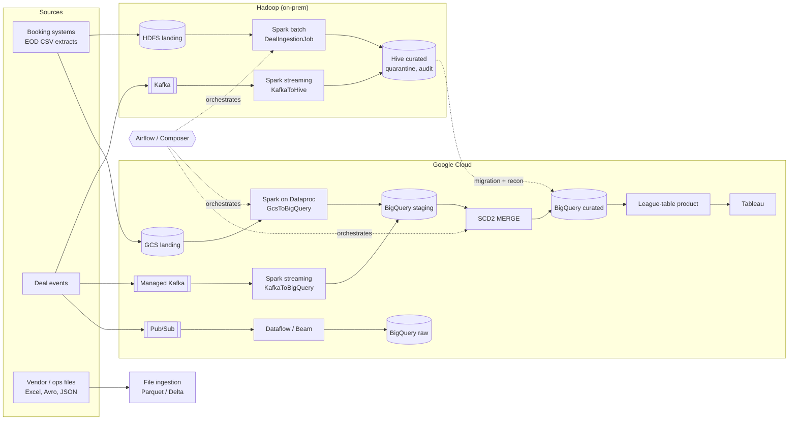

# CMA Data Engineering Pipelines

Example production-style data pipelines for a **Capital Markets & Advisory (CMA)** data platform in a
global bank, built with **Spark/Scala on Hadoop and Google Cloud**, **Kafka**, **Apache Beam / Dataflow**,
**BigQuery**, **Airflow / Cloud Composer**, **Maven**, **Jenkins** and **Ansible**.

The domain is syndicated deals (loans, bonds, ECM): booking-system extracts and deal events are validated,
enriched with party and FX reference data, loaded to curated tables and turned into front-office data products,
with data-quality gates, quarantine, reconciliation and audit evidence at every step.

> All data in this repo is synthetic. Names, identifiers and hosts are illustrative.

---

## Pipelines

| # | Pipeline | Platform | Tech | Module |
|---|----------|----------|------|--------|
| 1 | Daily deal ingestion: HDFS CSV → validate → Hive curated | Hadoop (YARN) | Spark/Scala, Hive | `hadoop-batch` |
| 2 | Daily deal load: GCS CSV → validate → BigQuery staging | GCP (Dataproc) | Spark/Scala, spark-bigquery | `gcp-dataproc` |
| 3 | Hive → BigQuery migration with row/amount/checksum reconciliation | GCP (Dataproc + Hive metastore) | Spark/Scala | `gcp-dataproc` |
| 4 | Kafka deal events → Hive (streaming, DLQ topic) | Hadoop (YARN) | Spark Structured Streaming | `kafka-streaming` |
| 5 | Managed Kafka deal events → BigQuery (streaming, DLQ topic) | GCP (Dataproc) | Spark Structured Streaming | `kafka-streaming` |
| 6 | Pub/Sub deal events → BigQuery (streaming, DLQ topic) | GCP (Dataflow) | Apache Beam (Scala), Flex Template | `dataflow-beam` |
| 7 | File ingestion: CSV / JSON / Avro / Excel → Parquet / Delta Lake | Hadoop **or** GCP | Spark/Scala, spark-avro, spark-excel, Delta | `file-ingestion` |
| 8 | Staging → curated **SCD type 2** MERGE | GCP | BigQuery SQL scripting | `bigquery/pipelines` |
| 9 | Monthly league-table data product (front office / Tableau) | GCP | BigQuery SQL | `bigquery/pipelines` |
| 10 | Post-load DQ assertions with audit evidence | GCP | BigQuery `ASSERT` | `bigquery/dq` |
| 11 | Pipeline reconciliation notebook | GCP, Hadoop, local | PySpark, Jupyter, papermill | `notebooks` |

Orchestration: `airflow/dags` — `cma_deals_gcp` (Composer), `cma_deals_hadoop`, `cma_stream_health`,
`cma_hive_to_bq_migration`.



---

## Design highlights

**One rule set, every engine.** Deal transformation and validation live once in `common`
(`DealPipeline`, `DealRules`). The Hadoop, Dataproc and Kafka jobs only differ in how they read and write.
The Beam pipeline uses a Spark-free `DealRecordValidator`, and `DealRecordValidatorParitySpec` fails the build
if it ever disagrees with the Spark rules on any input.

**Error handling is part of the contract.**

| Mechanism | Where |
|---|---|
| Typed errors with exit codes and a `retryable` flag | `common/errors/PipelineError.scala` |
| Exponential-backoff retry for transient faults only (HDFS, GCS, BigQuery 5xx, network) | `common/util/Retry.scala` |
| Bad records quarantined with the rule(s) they broke, never silently dropped | `Quarantine`, Hive / BigQuery reject tables |
| DQ gate blocks the write on Error-severity breaches, warns on Warn | `DataQuality`, `DealRules.curatedGate` |
| Reconciliation: input = loaded + rejected + superseded; read-back totals = written totals | `Reconciliation`, every job |
| Idempotent re-runs: partition overwrite, SCD2 no-op on unchanged rows, Delta `replaceWhere` / `MERGE` | jobs, SQL |
| Streaming: checkpoints, batch ledger against replays, dead-letter topics with reasons in headers | `StreamingDealJob`, Beam pipeline |
| Airflow retries infra failures but fails fast on data errors (exit code aware) | `airflow/dags/cma_common/operators.py` |
| BigQuery scripts run in transactions; roll back and re-raise | `bigquery/pipelines` |
| Failed deploy or smoke test → automatic rollback | `Jenkinsfile`, `ansible/playbooks/rollback.yml` |

Exit codes: `0` ok · `1` unexpected · `2` config · `3` source missing · `4` schema · `5` data quality ·
`6` reconciliation · `7` transient I/O · `8` sink write. See [docs/runbook.md](docs/runbook.md).

---

## Testing

Everything runs **locally with no cluster, cloud account or Kafka broker**:

| Pipeline | How it is tested locally |
|---|---|
| Hadoop batch | Files mode against `data/sample`, **and** real Hive mode on an embedded Derby metastore applying the production DDL |
| GCS → BigQuery, Hive → BigQuery | `InMemoryWarehouse` fake for BigQuery; includes a lossy sink to prove reconciliation catches it |
| Kafka → Hive / BigQuery | `MemoryStream` in place of Kafka, real checkpointing, foreachBatch, batch ledger and DLQ |
| Dataflow / Beam | DirectRunner + `PAssert` |
| File ingestion | Avro and Excel fixtures generated in the tests; every source/target combination |
| BigQuery SQL | Rendered as Airflow/Ansible would and checked for structure (pytest); real dry run in Jenkins |
| Airflow | DagBag integrity, SQL include rendering, exit-code retry policy |
| End to end | CI `spark-submit`s the Hadoop job on sample data, then runs the reconciliation notebook against the output |

```bash
mvn verify                                   # all Scala modules + tests (Java 17, Maven 3.9)
pip install -r airflow/requirements-dev.txt --constraint \
  https://raw.githubusercontent.com/apache/airflow/constraints-2.9.3/constraints-3.11.txt
pytest airflow/tests bigquery/tests notebooks/tests
```

Run a pipeline on your laptop:

```bash
mvn -pl hadoop-batch -am package -DskipTests
pip install pyspark==3.5.1 papermill
spark-submit --master "local[2]" --class com.example.cma.hadoop.DealIngestionJob \
  hadoop-batch/target/hadoop-batch-*-all.jar --env local --business-date 2026-10-26
papermill notebooks/pipeline_reconciliation.ipynb out.ipynb -p PLATFORM local -p REPO_ROOT "$PWD"
```

Environment smoke tests (DEV/UAT; PROD read-only) run after every deployment:
`ansible-playbook -i ansible/inventories/<env> ansible/playbooks/smoke_test.yml`.

---

## CI/CD

* **GitHub Actions** (`.github/workflows/ci.yml`): Maven build and Scala tests, Airflow/SQL/notebook tests,
  Ansible lint and syntax checks, local end-to-end run plus reconciliation notebook.
* **Jenkins** (`Jenkinsfile`): build and test → static checks (DAGs, BigQuery dry run, Ansible) → publish to
  Nexus → deploy DEV → smoke test → **approval** → UAT → smoke test → **approval + change ticket** → PROD
  (release tags only) → read-only smoke test. Any failed deployment or smoke test triggers an automatic rollback;
  `ROLLBACK_TO` redeploys a given version.
* **Ansible** (`ansible/`): versioned releases with atomic `current` symlinks on Hadoop edge nodes;
  jars to GCS with a kept `previous`; Hive and BigQuery DDL (idempotent); Composer DAG and SQL upload;
  restarts of the streaming jobs (resume from checkpoints); Dataflow Flex Template build and in-place `--update`.

---

## Repository layout

```
common/            shared library: errors, retry, config, DQ, quarantine, reconciliation, deal rules
hadoop-batch/      Spark/Scala on YARN + Hive (DealIngestionJob), Hive DDL
gcp-dataproc/      Spark/Scala on Dataproc: GCS -> BigQuery, Hive -> BigQuery migration
kafka-streaming/   Spark Structured Streaming: Kafka -> Hive, Managed Kafka -> BigQuery
dataflow-beam/     Apache Beam (Scala) on Dataflow: Pub/Sub -> BigQuery, Flex Template
file-ingestion/    CSV/JSON/Avro/Excel -> Parquet/Delta, Hadoop or GCP
bigquery/          DDL, SCD2 merge, data product, DQ assertions, SQL tests
airflow/           DAGs, shared config/callbacks/operators, tests
notebooks/         PySpark reconciliation notebook (+ generator and tests)
ansible/           inventories (dev/uat/prod), deploy / rollback / smoke-test roles
ci/                Maven settings, BigQuery dry run, CI failure annotations
data/sample/       synthetic deals (with deliberate bad rows), reference data, events
docs/              runbook, source-to-target mapping
```

## Mapping to the role

| Role requirement | Where it is demonstrated |
|---|---|
| Hadoop, Hive, HDFS, Spark, Scala | `hadoop-batch`, `kafka-streaming`, `file-ingestion` |
| BigQuery, Dataproc, Cloud Storage, Pub/Sub, Dataflow, Composer/Airflow | `gcp-dataproc`, `dataflow-beam`, `bigquery`, `airflow` |
| Migration of workloads to Google Cloud | `HiveToBigQueryMigrationJob`, `cma_hive_to_bq_migration` DAG |
| Data modelling (relational and non-relational), SCD2, partitions, views | `bigquery/ddl`, `bigquery/pipelines`, Hive DDL, Delta |
| Data quality: completeness, validity, uniqueness, consistency, timeliness, reconciliation, referential integrity | `common/quality`, `common/recon`, `bigquery/dq`, notebook |
| Unit and integration testing, automated build and deploy | tests in every module, CI, Jenkins, Ansible |
| Git, Jenkins, Ansible, Jira-ready delivery | this repo, `Jenkinsfile`, `ansible/` |
| Lineage, ownership, permitted use, documentation | `run_id` / `_source_file` lineage columns, table options, `docs/` |
